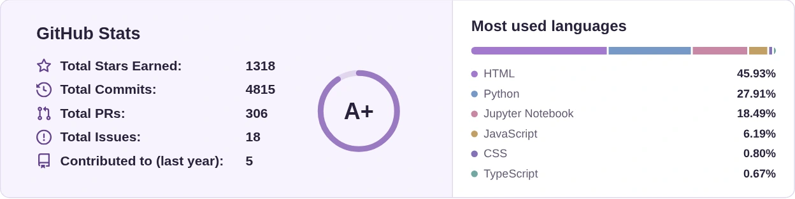
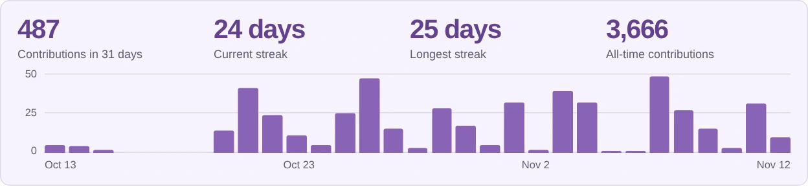
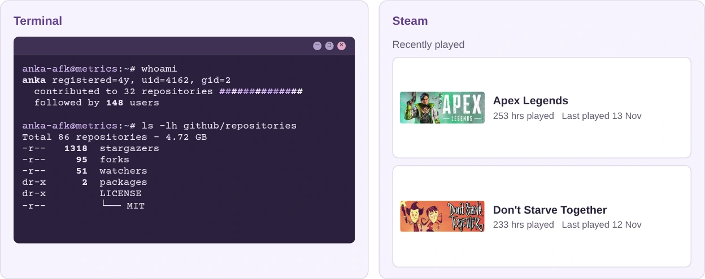
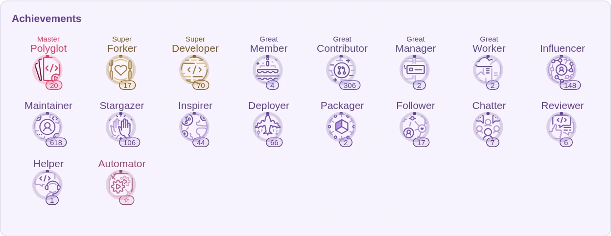
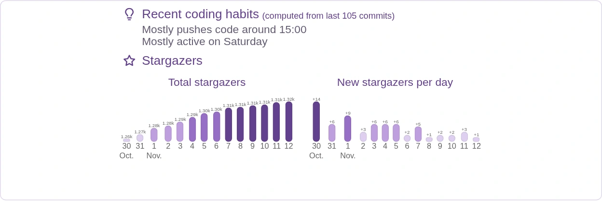

<picture>
  <source media="(max-width: 650px) and (prefers-color-scheme: dark)" srcset="images/profile/hero-mobile-dark.webp" />
  <source media="(max-width: 650px)" srcset="images/profile/hero-mobile-light.webp" />
  <source media="(prefers-color-scheme: dark)" srcset="images/profile/hero-desktop-dark.webp" />
  
</picture>

  <a href="https://ankaanka.org/"><picture><source media="(prefers-color-scheme: dark)" srcset="https://img.shields.io/badge/Blog-38294E?style=flat&amp;logo=rss&amp;logoColor=D8BAFF" /></picture></a>
  <a href="https://space.bilibili.com/26584382"><picture><source media="(prefers-color-scheme: dark)" srcset="https://img.shields.io/badge/Bilibili-38294E?style=flat&amp;logo=bilibili&amp;logoColor=D8BAFF" /></picture></a>

## GitHub at a glance

<picture>
  <source media="(max-width: 650px) and (prefers-color-scheme: dark)" srcset="images/profile/overview-mobile-dark.webp" />
  <source media="(max-width: 650px)" srcset="images/profile/overview-mobile-light.webp" />
  <source media="(prefers-color-scheme: dark)" srcset="images/profile/overview-desktop-dark.webp" />
  
</picture>

## Contribution activity

<picture>
  <source media="(max-width: 650px) and (prefers-color-scheme: dark)" srcset="images/profile/activity-mobile-dark.webp" />
  <source media="(max-width: 650px)" srcset="images/profile/activity-mobile-light.webp" />
  <source media="(prefers-color-scheme: dark)" srcset="images/profile/activity-desktop-dark.webp" />
  
</picture>

## Skills & technologies

  <picture><source media="(prefers-color-scheme: dark)" srcset="https://img.shields.io/badge/Python-38294E?style=flat&amp;logo=python&amp;logoColor=D8BAFF" /></picture>
  <picture><source media="(prefers-color-scheme: dark)" srcset="https://img.shields.io/badge/PyTorch-38294E?style=flat&amp;logo=pytorch&amp;logoColor=D8BAFF" /></picture>
  <picture><source media="(prefers-color-scheme: dark)" srcset="https://img.shields.io/badge/TensorFlow-38294E?style=flat&amp;logo=tensorflow&amp;logoColor=D8BAFF" /></picture>
  <picture><source media="(prefers-color-scheme: dark)" srcset="https://img.shields.io/badge/C%2B%2B-38294E?style=flat&amp;logo=cplusplus&amp;logoColor=D8BAFF" /></picture>
  <picture><source media="(prefers-color-scheme: dark)" srcset="https://img.shields.io/badge/JavaScript-38294E?style=flat&amp;logo=javascript&amp;logoColor=D8BAFF" /></picture>
  <picture><source media="(prefers-color-scheme: dark)" srcset="https://img.shields.io/badge/TypeScript-38294E?style=flat&amp;logo=typescript&amp;logoColor=D8BAFF" /></picture>
  <picture><source media="(prefers-color-scheme: dark)" srcset="https://img.shields.io/badge/React-38294E?style=flat&amp;logo=react&amp;logoColor=D8BAFF" /></picture>
  <picture><source media="(prefers-color-scheme: dark)" srcset="https://img.shields.io/badge/Vue.js-38294E?style=flat&amp;logo=vuedotjs&amp;logoColor=D8BAFF" /></picture>
  <picture><source media="(prefers-color-scheme: dark)" srcset="https://img.shields.io/badge/Node.js-38294E?style=flat&amp;logo=nodedotjs&amp;logoColor=D8BAFF" /></picture>
  <picture><source media="(prefers-color-scheme: dark)" srcset="https://img.shields.io/badge/MongoDB-38294E?style=flat&amp;logo=mongodb&amp;logoColor=D8BAFF" /></picture>
  <picture><source media="(prefers-color-scheme: dark)" srcset="https://img.shields.io/badge/MySQL-38294E?style=flat&amp;logo=mysql&amp;logoColor=D8BAFF" /></picture>
  <picture><source media="(prefers-color-scheme: dark)" srcset="https://img.shields.io/badge/Docker-38294E?style=flat&amp;logo=docker&amp;logoColor=D8BAFF" /></picture>
  <picture><source media="(prefers-color-scheme: dark)" srcset="https://img.shields.io/badge/Linux-38294E?style=flat&amp;logo=linux&amp;logoColor=D8BAFF" /></picture>
  <picture><source media="(prefers-color-scheme: dark)" srcset="https://img.shields.io/badge/Git-38294E?style=flat&amp;logo=git&amp;logoColor=D8BAFF" /></picture>

## Profile details

<picture>
  <source media="(max-width: 650px) and (prefers-color-scheme: dark)" srcset="images/profile/details-mobile-dark.webp" />
  <source media="(max-width: 650px)" srcset="images/profile/details-mobile-light.webp" />
  <source media="(prefers-color-scheme: dark)" srcset="images/profile/details-desktop-dark.webp" />
  
</picture>

<picture>
  <source media="(max-width: 650px) and (prefers-color-scheme: dark)" srcset="images/profile/achievements-mobile-dark.webp" />
  <source media="(max-width: 650px)" srcset="images/profile/achievements-mobile-light.webp" />
  <source media="(prefers-color-scheme: dark)" srcset="images/profile/achievements-desktop-dark.webp" />
  
</picture>

  
Coding habits &amp; stargazers

<picture>
  <source media="(max-width: 650px) and (prefers-color-scheme: dark)" srcset="images/profile/extras-mobile-dark.webp" />
  <source media="(max-width: 650px)" srcset="images/profile/extras-mobile-light.webp" />
  <source media="(prefers-color-scheme: dark)" srcset="images/profile/extras-desktop-dark.webp" />
  
</picture>

## Contribution snake

<picture>
  <source media="(prefers-color-scheme: dark)" srcset="https://raw.githubusercontent.com/anka-afk/anka-afk/output/github-contribution-grid-snake-dark.svg" />
  
</picture>
